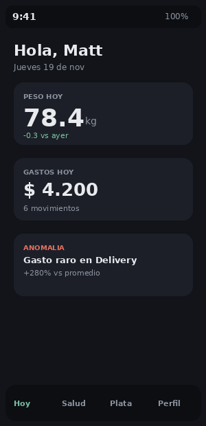
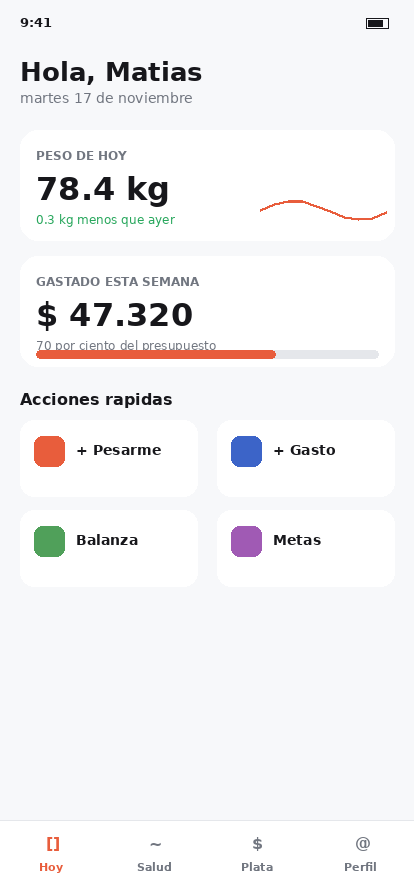
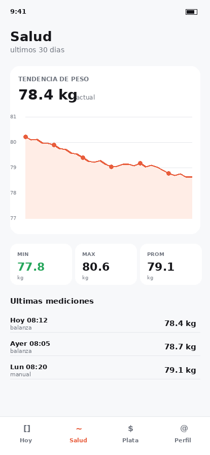
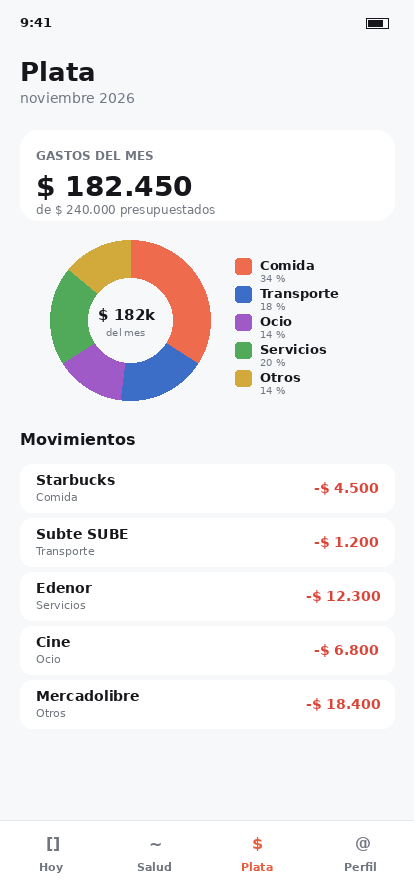
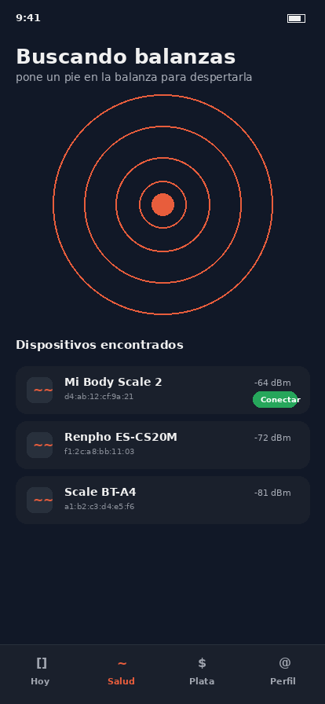

# pulso_mobile

App movil de Pulso, armada con Flutter. Es mi side project y parte
del portfolio.

Pulso trackea peso (salud) y plata (gastos) en el mismo lugar, se
conecta a balanzas inteligentes via BLE y manda los datos al
backend ([pulso-api](https://github.com/MatiasHernanSerrato/pulso-api)).
El frontend web vive en
[pulso-web](https://github.com/MatiasHernanSerrato/pulso-web).

[](https://github.com/MatiasHernanSerrato/pulso-mobile/actions/workflows/flutter.yml)


## Indice

- [Demo](#demo)
- [Pantallas](#pantallas)
- [Que hace](#que-hace)
- [Arquitectura](#arquitectura)
- [Correr el proyecto](#correr-el-proyecto)
- [Tests](#tests)
- [CI](#ci)
- [APK para demos](#apk-para-demos)
- [Releases y OTA con Shorebird](#releases-y-ota-con-shorebird)
- [BLE: balanzas inteligentes](#ble-balanzas-inteligentes)
- [Roadmap corto](#roadmap-corto)
- [Licencia](#licencia)

## Demo

<p align="center">
  
</p>

Un loop de 4 segundos recorriendo Hoy, Salud, Plata y el scanner
BLE. Es un render offline hecho a mano, no sale de un emulador,
pero refleja los tamanios y la paleta reales.

## Pantallas

<p align="center">
  
  
  
  
</p>

De izquierda a derecha: home con el resumen del dia, detalle de
peso con tendencia de 30 dias, gastos por categoria, y el scanner
BLE buscando balanzas.

## Que hace

- Loguear peso manual o automatico desde balanza BLE.
- Ver tendencia de peso (fl_chart) y alertas simples cuando hay
  mediciones raras (eso lo decide la api).
- Registrar gastos con categorias y ver cuanto se fue por rubro.
- Dashboard "hoy" que mezcla ambas cosas en un solo vistazo, que
  era la idea original del proyecto.
- Modo claro y oscuro, controlado desde perfil.

Las cosas que **no** hace todavia: sync con HealthKit / Health
Connect (viene), notifs push, importar extractos bancarios, y
multi-usuario en una misma cuenta.

## Arquitectura

El codigo esta cortado por features bajo `lib/features/`, no por
capas. Cada feature tiene su propio `domain/`, `application/`,
`data/` y `presentation/`. Las partes que son transversales viven
en `lib/core/`.

```
lib/
  main.dart             ; entry point, ProviderScope + splash
  app/                  ; routing, theming, shell con bottom nav
    router.dart
    shell.dart
    theme.dart
    theme_mode_controller.dart
  core/                 ; cosas compartidas entre features
    auth/               ; token storage (secure storage)
    network/            ; dio provider + auth interceptor
  features/
    hoy/                ; dashboard del dia
    salud/              ; peso: form, lista, grafico, controllers
    plata/              ; gastos: ingreso, categorias
    ble/                ; scan + connect + parser Weight Scale
    perfil/             ; settings, theme, logout
test/
  core/
  features/             ; tests unitarios, uno por feature
```

### Capas por feature

- **domain**: modelos puros y errores (freezed). No conocen Flutter
  ni Dio.
- **application**: controllers de Riverpod. Reciben casos de uso o
  llaman al repo directamente si la logica es trivial.
- **data**: repo / data sources. Aca entra dio para HTTP, drift
  para storage offline (viene), flutter_blue_plus para BLE.
- **presentation**: widgets. Solo leen providers con `ref.watch`,
  nunca instancian clases de data a mano.

Esta division me evito varias veces mezclar un `BuildContext` en
un lugar donde no iba.

### Flujo de datos

```
UI (ConsumerWidget)
   | ref.read / ref.watch
   v
Controller (StateNotifier / AsyncNotifier)
   | await
   v
Repository
   | (http / ble / local db)
   v
pulso-api | balanza BLE | drift (offline)
```

Riverpod 2.5 con code generation. Los providers que exponen state
usan `@riverpod` para generar las variantes `.notifier` y `.future`
sin escribirlas a mano.

### Navegacion

go_router 14. El root es una shell con bottom nav de 4 pestanias
(`Hoy`, `Salud`, `Plata`, `Perfil`). Cada pestana tiene su propio
`StatefulShellBranch` asi conserva el stack cuando vuelvo a ella.

### Red y auth

- `core/network/dio_provider.dart` arma un `Dio` con base URL que
  sale de `--dart-define=API_URL`. Default a `http://10.0.2.2:8080`
  para el emulador de Android y `http://localhost:8080` en iOS.
- `core/network/auth_interceptor.dart` agarra el JWT de
  `TokenStorage` (flutter_secure_storage) y lo pega como
  `Authorization: Bearer ...`. Cuando ve un 401, limpia el token y
  dispara un refresh del `authControllerProvider`.
- GraphQL contra pulso-api; el schema esta tipado del lado del
  servidor con gqlgen.

### BLE

Ver seccion propia mas abajo. Spoiler: perfil estandar Weight
Scale, `0x181D` service, `0x2A9D` characteristic, reconexion con
backoff.

## Correr el proyecto

```bash
flutter pub get
flutter run --dart-define=API_URL=http://10.0.2.2:8080
```

Requiere Flutter 3.24 o mas nuevo. Si tenes fvm, hay un `.fvm`
pinneado.

Para apuntar a la api desplegada:

```bash
flutter run --dart-define=API_URL=https://pulso-api.fly.dev
```

## Tests

```bash
flutter test
flutter test --coverage
```

El analyze estricto corre en CI pero tambien lo podes correr
local:

```bash
dart format --set-exit-if-changed .
flutter analyze
```

## CI

En `.github/workflows/flutter.yml`:

- `analyze + test` en cada push a `main` y en cada PR, con coverage
  subido como artifact.
- `android debug build` solo despues de que analyze y test pasen,
  para asegurarse de que compila.

Tiene `concurrency` para cancelar runs viejos cuando empujo varios
commits seguidos.

## APK para demos

Para mandarle la app a alguien sin pasar por Play, tengo un script que arma APKs split por ABI apuntando ya a la api de prod:

```bash
./scripts/build-demo-apk.sh
```

Los deja en `build/demo/` con fecha + ABI en el nombre. En general mando el `arm64-v8a` que es lo que tienen 9 de cada 10 Android actuales. Son unos 22 MB.

Si querés apuntarlo a otra api, podes exportar `API_URL`:

```bash
API_URL=http://192.168.1.50:8080 ./scripts/build-demo-apk.sh
```

Para el signing hay que armar `android/key.properties` a partir de `key.properties.example`. Sin ese archivo cae a debug signing (sirve para probar en tu device, no para distribuir).

## Releases y OTA con Shorebird

Uso Shorebird para mandar patches OTA sin pasar por los stores.
Config en `shorebird.yaml` (root) y
`ios/Flutter/Shorebird.xcconfig`.

Flow tipico de una release:

```bash
# release completo (store + baseline del patch)
shorebird release ios
shorebird release android

# patch OTA (solo dart, sin pasar por store)
shorebird patch ios
shorebird patch android
```

Reglas que me hice:

- Si toco codigo nativo (plugins, Info.plist, build.gradle) va a
  release, no a patch.
- Si solo cambia Dart va a patch.
- Un release por sprint, patches a demanda cuando hay bug chico.

## BLE: balanzas inteligentes

Pulso lee peso directamente de balanzas BLE que implementen el
perfil estandar **Weight Scale** (service UUID `0x181D`,
characteristic `0x2A9D`), definido por la Bluetooth SIG.

El flujo es asi: la app pide permisos, escanea, el usuario toca la
balanza en la lista, nos conectamos, descubrimos servicios y nos
suscribimos a notifications de la char de peso. Cuando llega un
paquete lo parseamos, convertimos a kg si vino en libras, y lo
guardamos en el controller de weights.

Los archivos relevantes:

- `lib/features/ble/application/ble_permissions.dart` permisos por
  plataforma.
- `lib/features/ble/application/scan_controller.dart` scan + filtro
  por service UUID.
- `lib/features/ble/application/scale_connection.dart` conexion,
  discover services, reconexion automatica.
- `lib/features/ble/data/weight_measurement_parser.dart` parser del
  paquete 0x2A9D.
- `lib/features/ble/application/measurement_listener.dart` subscribe
  a notifications y guarda en db.

### Permisos

En Android 12+ pedimos `BLUETOOTH_SCAN` (con `neverForLocation`) y
`BLUETOOTH_CONNECT`. En Android <= 11 cae a `BLUETOOTH`,
`BLUETOOTH_ADMIN` y `ACCESS_FINE_LOCATION`, que es lo que pedia el
stack viejo. En iOS declaramos `NSBluetoothAlwaysUsageDescription`
y `bluetooth-central` en background modes.

### Limitaciones conocidas

Me parece importante escribir esto porque la mitad de las balanzas
que se venden como "smart" hacen cosas raras.

- **Balanzas no-SIG**: muchas marcas chinas (Xiaomi Mi Scale v1,
  algunas Huawei) no implementan el perfil Weight Scale; usan un
  service vendor-specific. Por ahora las ignoramos. Si el
  advertisement NO incluye `0x181D`, la UI las muestra pero avisa
  que probablemente no sirvan.
- **% de grasa corporal**: lo manda el perfil `Body Composition`
  (`0x181B`), no lo parseamos todavia. Entra en la proxima
  iteracion.
- **Timestamps**: algunas balanzas prenden el flag de timestamp en
  el paquete y despues mandan basura en esos bytes (firmwares
  rotos). Si detectamos year 0 o mes fuera de rango, caemos a
  `DateTime.now()` y no perdemos la medicion.
- **Reconexion**: la mayoria de las balanzas se duermen a los 30
  segundos de inactividad. Si durante ese tiempo cae la conexion
  probamos 4 reintentos con backoff (1s, 3s, 6s, 10s). Despues de
  eso pedimos al usuario que vuelva a tocar la balanza.
- **Multi-usuario**: las balanzas con perfiles multi-user mandan
  user id en el paquete, lo guardamos pero todavia no lo asociamos
  a usuarios de Pulso. Si vive mas de una persona en la casa, el
  que se para arriba gana.
- **iOS en background**: declaramos `bluetooth-central` pero no
  corremos listener en background sostenido todavia. El flujo
  asume que el usuario tiene la app abierta cuando se pesa.
- **Emuladores**: el BLE no funciona en el simulador de iOS y es
  poco confiable en los emuladores de Android. Para probar hace
  falta un device fisico.

## Roadmap corto

- [ ] Body composition parser (`0x181B`, `0x2A9C`).
- [ ] Sync con Apple Health y Health Connect.
- [ ] Storage offline con drift + outbox pattern para pushear
      cuando vuelva red.
- [ ] Notifs push con metas semanales.
- [ ] Soporte para Xiaomi Mi Scale v2 (protocolo propietario, ya
      hay librerias que lo mapean).

## Licencia

MIT. Ver [LICENSE](./LICENSE). Hace lo que quieras, no me pidas
soporte.
